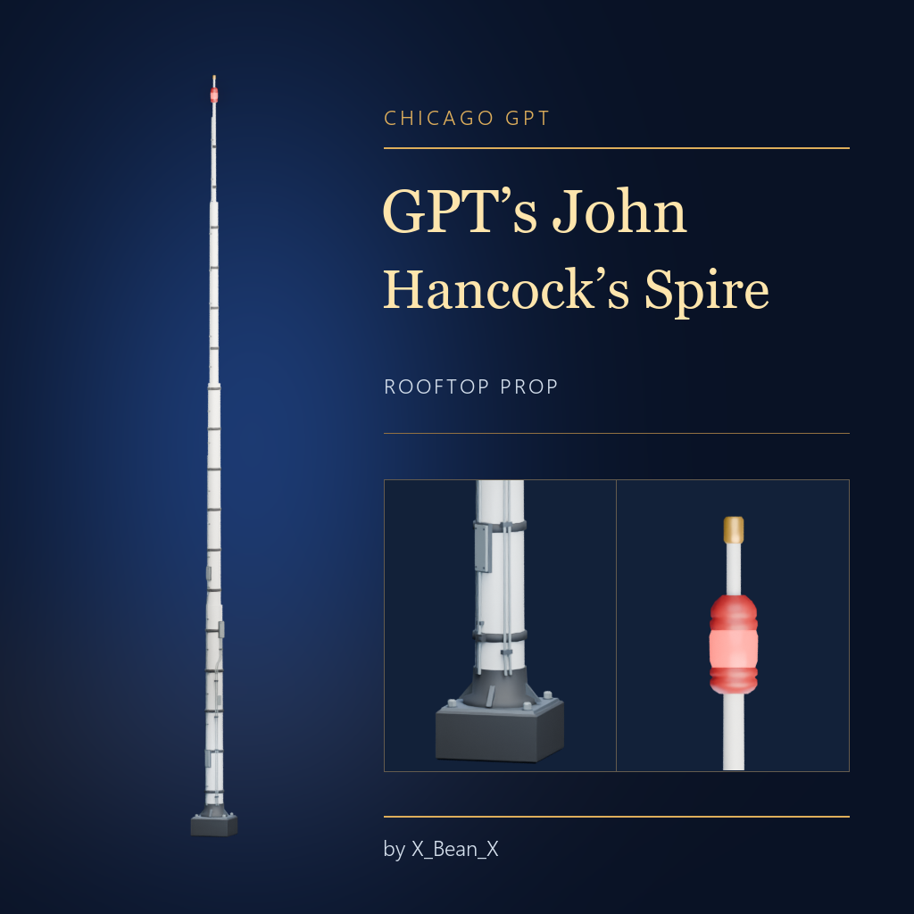

# GPT's John Hancock's Spire by X_Bean_X

A standalone Cities: Skylines II rooftop prop by **X_Bean_X** for Chicago GPT.

- 60 m segmented mast, 3 × 3 m bolted mounting base and bottom-center pivot.
- Clipped conduit, bent feeds, three junction boxes, ribbed red lens and gold cap.
- Native two-second emissive beacon cycle at normal speed. The prop has no required mods or DLC.

## Install and place

Use **Paradox Mods** in CS2. The [1.0.0 release](https://github.com/X-X-Bean-X-X/GPTsJohnHancocksSpire/releases/tag/v1.0.0) also contains the original native package. For a manual install on Windows, extract the .cok and matching .cok.cid into a custom asset folder under %LOCALAPPDATA%\..\LocalLow\Colossal Order\Cities Skylines II\ such as X_Bean_X\Installed, then restart CS2. Use one installation method for the prop. Look under Industrial Props in the Editor and set the base at roof height.

## Build from source

- Open **Source/Hancock Spire V1.blend** in Blender 5.2.1 or use the supplied FBXs and 512 px texture maps in **Import**. To regenerate the import files, create the Source, Import and Validation folders and run Blender in background mode with **--python Tools/build_spire.py**.
- Import the main mesh and both LODs through the CS2 Editor. Use the Static Object preset and an Industrial Props UI category. The mesh origin is already at the center of the mounting plate.
- Use the asset's native emissive texture and a Decorative Light curve on material 0. The curve runs 120 frames. The exact native prefab definitions are under **Native**.
- **Tools/SpireAuthor.cs** is the project authoring helper for the existing Chicago Build Bridge and CS2 assemblies. It accepts a workRoot containing Import, Package, Validation and Icon.png. The downloadable package is a data-only asset.
- **Tools/render_spire.py** renders the thumbnail elements from the Blender file. Pass an output directory after **--** and run **Tools/compose_thumbnail.py** with that directory using Python and Pillow on Windows.

Verified in CS2 1.6.4f1 through a cold start and two placements in an isolated Editor, at ground level and 28 m up. Both beacons cycled automatically. The model, materials and tooling were authored with AI assistance.

Native package SHA-256

c9b623800d99c4ca207af0fd7ebb800aad7bdb2579f6fa15b5e4e86dcb9e4b0a
